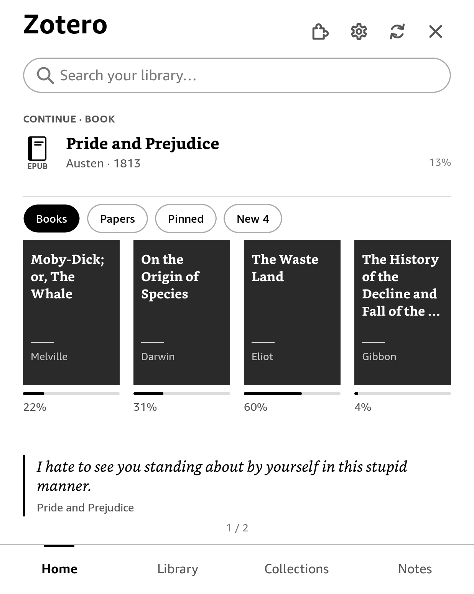

# Reading Desk

A Home for [Zotero for Kindle](https://github.com/ievlevpn/zotero-for-kindle): what you're in the middle of,
a shelf of books, the papers next in line, your pins, what's new in an inbox, and a passage from your
highlights each day.



## Install

On the Kindle (Zotero for Kindle 0.11.0 or later): *Settings → Plugins → Get plugins → Reading Desk →
Install*, turn it on, then *Settings → Home → Reading Desk — Reading Desk*. To go back, choose *Built-in*
there; if the plugin stops, Home goes back by itself.

## What it shows

- **Now reading** — the item you opened last and haven't marked read, any kind, with the kicker
  **CONTINUE · BOOK** or **CONTINUE · PAPER** (a book is item type `book` or `bookSection`, or an
  EPUB file). A card on a tall screen (Scribe); on a Paperwhite or a basic Kindle a label over a
  row, so a shelf row and the passage fit under it. Nothing opened yet: **START HERE** with the
  newest unread pin; no pins either: nothing.
- **Tabs** — chips; the one you pick is kept.
  - **Books**: a shelf of the books in progress (most recent first), then your other pinned
    books.
  - **Papers**: rows of the papers in progress, then **UP NEXT**: pinned papers never opened on
    this Kindle and not marked read. When the two would page, they are one list (rows say "42%"
    or "new").
  - **Pinned**: a shelf of every pin, in the order pinned.
  - **New n**: unread items of the inbox collection, newest added first. Only with an inbox. At
    most the newest 100 are looked at ("New 99+"), so a big inbox doesn't slow Home down.

  "Now reading" is never listed again below it. "Unread" is the read mark, never progress: a
  book at 100% stays until you mark it read.
- **A passage** — one of your highlights (40–400 characters, from the newest 300), picked once a
  day and the same all day. The pick runs after Home has drawn (it then refreshes), never inside
  a render; until it has run, yesterday's passage shows. Tap it: the reader opens at that
  highlight; if the highlight was deleted the item opens where you left it, and if the item is
  gone another passage is picked. It goes under the tab's
  content when that fits, and is left out of a render where it would cost a page (it never pushes
  your items onto a second page). Off in the settings.

Taps on items open them; long-press shows the library's item menu. The app draws the items and
keeps their progress current; the plugin only picks the keys.

## Pins

Long-press an item → **More…** → **Pin to Home / Unpin**. The action toggles and says which it
did. At most 50 pins.

## Settings

Plugins → **Reading Desk**:

- **Inbox collection** — a searchable list of your collections, or *None* (no New tab).
- **A passage each day** — on or off.
- **Pinned** — your pins; tap one, then **Unpin**.

0.1's `settings.json` (`{ "inbox": "ABCD2345" }`, see `settings.example.json`) is still read
until you pick an inbox (or *None*) there.

## Permissions

`library:read`, for the items and collections; `annotations:read`, for the passage. What it keeps
is in the plugin's own storage: `pins` (`{ key, library }[]`), `tab`, `prefs` and the day's
`passage`.

## Build

```sh
npm install
node build.mjs        # dist/reading-desk/ — copy it to zotero/plugins/ on the Kindle
npx tsc -p .          # type-check
```

`types/zk.d.ts` is the plugin API from the app's `sdk/types/`.
