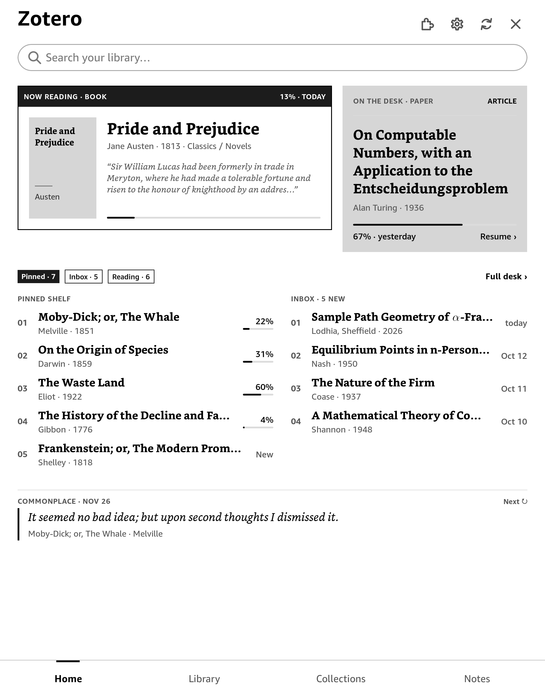
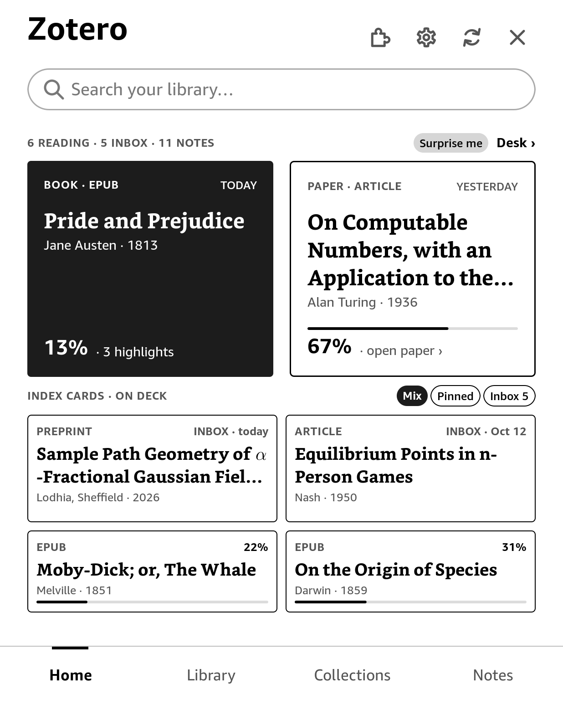
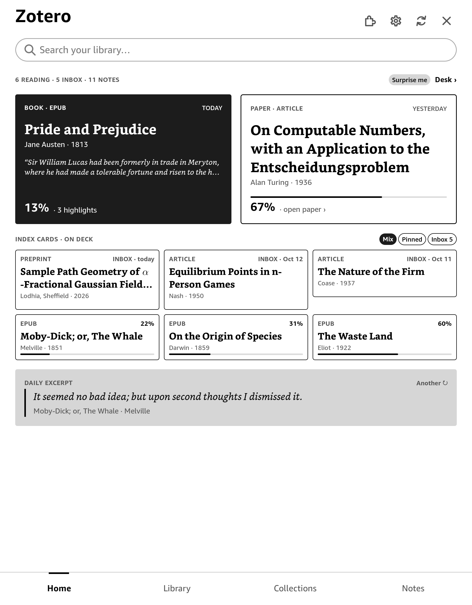
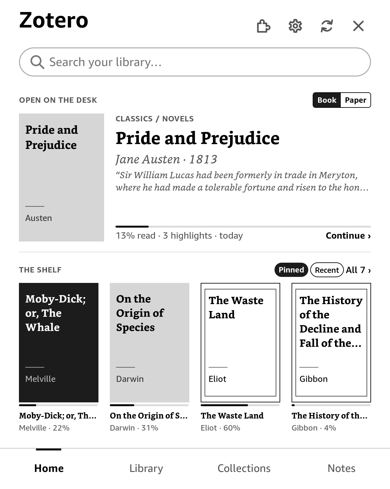
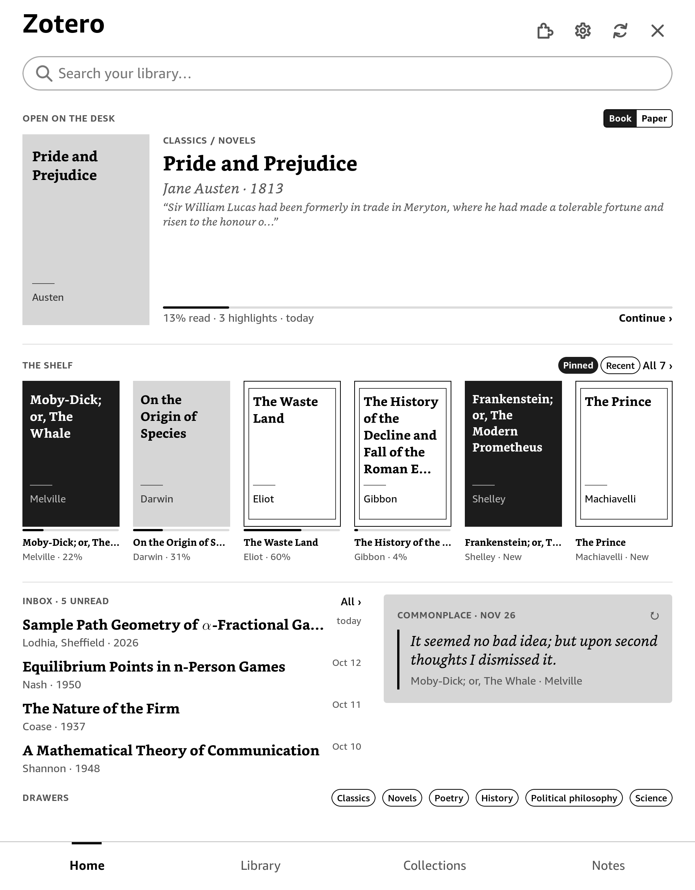

# Reading Desk

An alternative Home for [Zotero for Kindle](https://github.com/ievlevpn/zotero-for-kindle) with **three selectable e-ink layouts**, composed entirely from the app's `zk.ui` primitives (including native MicroTeX math rendering in paper titles).

## Three Home Layouts

Switch layouts anytime in *Plugins → Reading Desk → Home layout*:

---

### 1. Folio *(default — Editorial Broadsheet)*

- **Ink-header Book hero** with an italic excerpt of your **last highlight** in that book so you pick up right where your head was.
- **Shaded Companion Paper** beside it in a 63/37 spread on Scribe, or as a compact strip right beneath it on Paperwhite.
- **Inline `Pinned · Inbox · Reading` tabs** right on Home over a numbered catalog (`01`–`05`) with compact progress bars (side-by-side Pinned + Inbox on Scribe).
- **Commonplace** daily highlight at the foot with a one-tap **`Next ↻`** cycler.

| Kindle Paperwhite 5 | Kindle Scribe |
| :---: | :---: |
|  |  |

---

### 2. Index Desk *(Swiss Zettelkasten — Zero Redundant Covers)*

- **Desk telemetry strip** (`READING · INBOX · NOTES`) with a one-tap **`Surprise me`** pill that opens a random unread item from your inbox or pins.
- **High-contrast active diptych**: matte-black ink **Book** card paired with a thick-bordered crisp-white **Paper** card and bold progress numerals.
- **Typographic Index Card grid** (`2×2` on Paperwhite, `3×2` on Scribe) with inline **`Mix | Pinned | Inbox`** filter pills, format labels (`PREPRINT`, `ARTICLE`, `EPUB`), and native MicroTeX LaTeX rendering in titles.
- **Shaded Daily Excerpt** card with **`Another ↻`**.

| Kindle Paperwhite 5 | Kindle Scribe |
| :---: | :---: |
|  |  |

---

### 3. Reading Room *(Calm Spotlight + Captioned Shelf)*

- **Full-width spotlight** with an instant **`[Book | Paper]`** toggle in the corner, collection breadcrumb, and last-highlight snippet.
- **Captioned Cover Shelf** with inline **`Pinned | Recent`** switch, aligned progress bars, and `Author · %` captions.
- **Split lower study (Scribe)**: `INBOX` on the left and a shaded `COMMONPLACE` highlight card on the right.
- **Quick Drawers** strip at the bottom: one-tap collection pills that open *Your desk* filtered straight to that collection.

| Kindle Paperwhite 5 | Kindle Scribe |
| :---: | :---: |
|  |  |

---

All three layouts use `fit: "trim"` on Home's root column so Home never shows a pager and adapts cleanly to Scribe, Paperwhite, basic Kindle, and landscape orientation.

## Install

On the Kindle (Zotero for Kindle 0.16.0 or later): *Settings → Plugins → Get plugins → Reading Desk → Install*, turn it on, then *Settings → Home → Reading Desk — Reading Desk*. To go back, choose *Built-in* there; if the plugin stops, Home goes back by itself.

## Your desk

Tap **Full desk ›**, **Desk ›**, **All ›**, or any **Drawer** pill to open *Your desk*: a paged grid of captioned covers with a **Reading · Pinned · Inbox** switch (or the selected collection drawer, with an `All tabs ›` pill to return).

## Pins

Long-press any item → **More…** → **Pin to Home / Unpin**. At most 50 pins.

## Settings

*Plugins → Reading Desk*:

- **Home layout** — choose between *Folio*, *Index Desk*, and *Reading Room*.
- **Inbox collection** — searchable list of your collections, or *None*.
- **A passage each day** — on or off (tap the quote to jump straight to that highlight; tap `Next ↻` / `Another ↻` to cycle).
- **Pinned** — manage your pinned items.

## Permissions

`library:read` (items and collections) and `annotations:read` (last-highlight recall and daily commonplace passage). Stored privately in `zk.storage`: `pins`, `prefs`, `passage`, and a compact `hlSummary` cache.

## Build

```sh
npm install
npm run check         # TypeScript check
npm run build         # dist/reading-desk/
```
